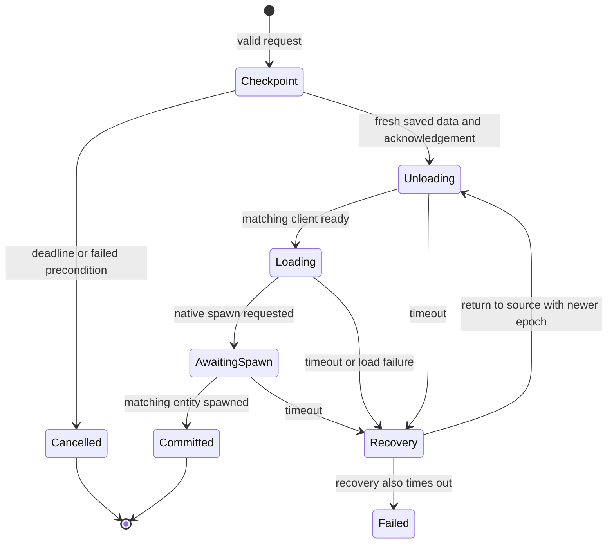

# Transfer, network, configuration and storage contracts

See [the evidence definitions and baseline](README.md). All upstream behavior below is static observation of 0.6.2 unless explicitly identified as a replacement requirement. The replacement need not be wire-compatible with Multiworld clients; matching new client/server versions can use a new protocol. Preserve semantics rather than copying package implementations.

## Transfer state machine

Each authenticated connection has a current world, monotonically increasing session epoch, and at most one active transfer. A transfer records an unpredictable token, source, destination, previously observed checkpoint generation, deadline, acknowledgement state, current phase, epoch and rollback flag. Upstream uses a 32-character GUID token without separators and a signed 32-bit epoch.

Recovery is an operation that starts another unload/load sequence; it is not an extra upstream enum value. The rollback flag follows that sequence. See the rules below for a timeout during rollback.

| Step | Observed action and guard | Required invariant |
| --- | --- | --- |
| Request | `/world` lists current/catalogue; `/world NAME` resolves case-insensitively | Resolve target server-side; do not accept a client-supplied path |
| Validate | Worlds ready; target open and different; logged in; no active transfer; player exists, alive, unattached; ten seconds since last completed travel | Reject mounted/dead/missing players without mutating their world |
| Prepare | Allocate token and remember checkpoint counter; deadline 30 seconds; send prepare | Source entity remains authoritative while no fresh checkpoint exists |
| Client checkpoint | Clear movement, disable control, send native player data, then a flushing acknowledgement | Acknowledgement alone does not prove fresh character data arrived |
| Server accept | Same token, before deadline, not already accepted, source still current, checkpoint counter increased, latest data matches live entity, alive and unattached | Persist shared checkpoint before detaching player |
| Detach | Save latest data; remove native party projection while retaining logical membership; notify quest disconnect; unlock player locks; despawn forced bosses; update persistent online state; remove chunk observer and entity; clear attached/entity/latest-data fields | Exactly one source removal; no partial duplicate destination entity |
| Switch | Increment epoch; route connection to target; send token, target and epoch; deadline 180 seconds | Old-world queued gameplay must never apply to the new world |
| Client unload | Capture reusable state, retain network channels, suppress normal session/resource shutdown, clean local world, reset loaded flags, start next game/world | Same transport/authentication survives; old load coroutines become obsolete |
| Ready | Client restarts configuration wait and sends token/epoch; server accepts only in Unloading, changes to Loading and invokes native enter-game coroutine | A stale ready from an earlier attempt cannot start another join |
| Spawn request | Native request accepted during Loading, moves to AwaitingSpawn and refreshes 180-second deadline | Destination data and world are usable before spawn completes |
| Commit | Native spawned event matches connection entity and real entity in resolved world, phase AwaitingSpawn | Persist preferred world only after confirmed spawn; remove request; record cooldown |
| Result | Send token, success flag, message; client restores control and clears transfer flags on success | Arrival, debug state and time synchronization finish against the committed entity |

The command parser also accepts a quoted world name, trims surrounding whitespace and requires a word boundary after `/world`; `/worldwide` is not a travel request. Server detach invokes quest disconnect and boss-despawn behavior. Restoring a journal is not sufficient evidence that every active quest survives: its objective targets, listeners, deadlines and disconnect semantics must be reviewed. Companion safe landing is applied during character restoration, before native spawning, and rechecked immediately before switching.

### Timeout, cancellation and disconnect

During Checkpoint, timeout removes the request and returns failure while the source remains attached. Client preparation has a separate 35-second watchdog that restores control if no switch began. After detachment, the first timeout starts a return to the original source with the same token and a newer epoch. A timeout while already rolling back sets Failed and returns an error; upstream retains the connection and saved character, and suppresses gameplay. It does not automatically establish a recovered playable session.

A client configuration failure is accepted only for the matching token/epoch during Loading, and invokes the same recovery mechanism. Result messages for another token are ignored. A successful rollback reports arrival in the source and commits that restored source state; this is recovery success, not a successful forward trip.

Real disconnect clears transfer/checkpoint/epoch/client-world mappings and logical party membership after native connection removal. Reconnect resolves the last persisted preferred world, or first-join world if none. Upstream has no durable transfer transaction journal; the shared checkpoint and preferred-world file are separate atomic writes. Crash behavior between these writes must be tested rather than inferred as fully transactional. The proposed replacement adds a durable intent/commit record; see [the plan](implementation-plan.md).

## Session packet isolation

All ordinary authenticated gameplay packages are wrapped with the destination connection's epoch. Connection/authentication packages and transfer controls remain outside the wrapper. A wrapper cannot contain another wrapper, transfer control or authentication packet. Unwrapped ordinary gameplay is rejected by the intercepted processing path.

Server ingress requires an authenticated sender and the current connection epoch; processing enters that sender's world. Client ingress requires a server-origin packet, matching current epoch, and no active unload. Check native packet direction and `ShouldProcess` before invoking `ProcessPackage`; preserve skipped-packet handling and release ownership. During server Unloading or Failed, gameplay is denied; re-enter-game requests are denied during transfer, and spawn requests are allowed only during Loading.

Before serialization, bind the epoch to the recipient, not whichever world the main thread currently has selected. Scope broadcasts, direct sends, incoming processing, disconnect and enter-game coroutines. Normal world broadcasts reach authenticated connections assigned to that world. Transfer control and pre-authentication paths need explicit exemptions. Process-wide presence/social snapshots are deliberate global messages, not leaked entity replication.

Queued world-info packages retain a snapshot of the owning map's file hashes and total size. Otherwise a package constructed under one world can be serialized after context changes and advertise the wrong terrain. The same principle applies to cached map-send data and future asynchronous packets.

Packet pools and send-reference accounting are part of correctness. Upstream increments the wrapped package's send reference and preserves channel, reliability, compression and flush properties. Dropping a package, failing serialization, processing/skipping it and resetting a pooled wrapper all need balanced releases. Do not assume garbage collection manages native package pools.

### Observed custom message catalogue

Names below identify inspected classes. New names and schemas are encouraged for the independent protocol. S→C means server to client; C→S means client to server. Fields are listed in observed serialization order after the native package header. BinaryWriter primitive/string conventions are inherited from the game; package numeric IDs must be obtained from registration, not hardcoded from names.

| Message suffix | Direction | Payload | Important bounds/behavior |
| --- | --- | --- | --- |
| Prepare | S→C | token string, destination string | Flush; client validates 32-character token and live unattached player |
| CheckpointAck | C→S | token string | Flush; requires increased server checkpoint counter |
| Switch | S→C | token string, destination string, epoch Int32 | Flush; client requires matching token and newer epoch |
| Ready | C→S | token string, epoch Int32 | Flush; accepted only in Unloading |
| LoadFailed | C→S | token string, epoch Int32 | Flush; accepted only in Loading |
| Result | S→C | token string, message string, success Boolean | Flush; matching token controls completion |
| Envelope | Both | epoch Int32, payload-byte-count Int32, native inner package bytes | Length 2–67,108,864 bytes; exact read; inner begins with native UInt16 ID; reject nesting |
| Catalogue | S→C | count Byte, repeated map string and GUID string | 1–64 pairs; safe single path components |
| MapRequest | C→S | GUID string, file string, request Int32, offset Int64 | GUID in 32-digit N format; file ≤128 chars; nonnegative offset; empty file requests manifest |
| MapData | S→C | GUID string, file string, request Int32, offset Int64, speed Int32; then manifest or bytes | Channel 1; compression; details below |
| QuestProgress | S→C | shared Boolean, world GUID string, count UInt16, repeated faction Byte and points Int32 | ≤256 factions; unique faction keys; points nonnegative; matching receiving world |
| Party | S→C | world GUID string, party ID Int32, voice-lobby string, member count Byte, member records | ≤8 members; world GUID ≤128 chars; lobby ≤1024 chars; matching receiving world |
| Players | S→C | world GUID string, count UInt16, presence records | ≤1024 records; unique primary identities; matching receiving world |
| Test | Diagnostic | No additional payload in inspected class | Not needed in a production replacement |

Party member records contain entity ID, name, world label, identity string, local-world/leader/has-vitals/Twitch Booleans, health/max-health Int32 and health/current-maximum/stamina/current-maximum fill Singles. Names are capped at 256 chars, world labels at 64 and identity strings at 256. These snapshots describe remote members without importing their entities.

Presence records contain the native `PlayerData` identity representation, entity ID, world name, level, stage, zombie kills, player kills, deaths and ping Int32 values, then an administrator Boolean. A primary identity is required; world names are capped at 64. Native PlayerData's binary identity representation is an engine dependency, not specified by this custom mod.

Replacement requirements: negotiate protocol/game compatibility explicitly; bound strings before large allocation; bound decompression and aggregate work; reject wrong direction, forged tokens, stale epochs, invalid lengths and unexpected state transitions. The upstream reader does not uniformly perform all these checks at the earliest possible point. Preserve the guarantees and improve validation rather than copying parser weaknesses.

## Map acquisition and caching

Upstream sends a catalogue before world information and intercepts initial client world creation until **all** configured maps are present and verified. This occurs independently of the optional in-memory preload optimization. It is a real bandwidth/storage cost for a 64-map grid.

The initial catalogue wait is 30 seconds. For each distinct GUID, request a manifest using an empty filename. A manifest response supplies count Int32 and repeated filename string, file size Int64, CRC UInt32. Reader limits: 1–128 files; unique case-insensitive filenames; each size 0–536,870,912 bytes; aggregate at most 2,147,483,648 bytes. Chunk responses supply count Int32 and exactly that many bytes, limited to 1–262,144 bytes. Each request has a 45-second wait and is correlated by request number, GUID, filename and offset. The server accepts requests only from authenticated non-transferring clients after readiness, for known open initialized worlds and manifest-listed files. Offsets must be within that file.

Only plain filenames with extensions `.raw`, `.png`, `.xml`, `.ttw`, `.txt` are eligible. Reject leading dots, separators, colon, control characters and invalid filename characters; do not turn the map server into an arbitrary file reader. Canonicalize and verify path containment in the replacement on both platforms.

Download into the native GUID-specific local-save `World` directory. Verify any existing file by exact length and CRC; download missing/invalid files into temporary files, update CRC incrementally, flush, validate final CRC, and atomically replace/move into place. Publish manifest/completion metadata only after success and invalidate world-path caches. Initial map acquisition failure stops joining and disconnects with an explanation. Transfer/disconnect cancels outstanding work using a generation counter and deletes partial temporaries. Native map sending has its own per-world cache and active-sender count; do not clear a cache while another sender still uses it.

Server speed guidance is nonnegative KiB/s; client throttles between chunk requests. CRC detects transfer corruption, not malicious content authenticity. A replacement can choose on-demand/neighbor downloading instead of all-map initial download, but must then add a destination-map readiness phase before detachment and update timeout/progress behavior.

The optional RAM cache defaults to 256 MiB, configurable 32–512 MiB. It scans eligible files in candidate installed/GUID-local directories, favors smaller files and noncurrent-map directories, skips files over 220 MiB, and records bytes, length, UTC write ticks and CRC. It serves read/read-all/CRC calls during switching only if current disk metadata still matches. Stale entries are evicted; generation cancellation and locks protect publication. Preload failures fall back to normal disk loading. The supplied `MapCacheTestStream` exists to test that cached memory streams cannot mutate underlying bytes; preserve immutability.

### Warm definition reuse

The fast-switch optimization can reuse parsed materials, physics bodies, painting, shapes, blocks, progression, buffs, misc, toolbelt, items and item modifiers. Reuse requires a successful complete prior config load, all eleven received compressed XMLs, no conditional XML blocks in those candidates, both block/item mapping byte arrays, identical incoming bytes, and unchanged live block/item definition arrays. Otherwise perform full definition loading.

Wait for destination configurations, honor optional/missing file rules, run cleanup/load/post-load callbacks for nonreused definitions, evaluate conditional XML, and yield during expensive work. Config-loading exceptions invalidate warm reuse, block spawn and send a matching load-failure message. Coroutines carry an epoch so a superseded load cannot finish into a newer world. Garbage-collection suppression is an optimization, not a correctness requirement. Start the independent implementation with full reloads and add caching after transfer tests pass.

## Configuration compatibility

Upstream's mod-local XML root is `LITWMultiWorld`, schemaVersion `1`. Root attributes include defaultWorld, storageId and optional mode (`runtime`/`test`, empty also accepted). StorageId permits 1–64 ASCII letters, digits, underscores or hyphens. It partitions shared characters/allies/preferences, and changing it points at a different shared store.

| Setting | Default/validation |
| --- | --- |
| World count | 1–64 |
| `defaultWorld` | Must reference a configured name; primary loads first |
| `Firstjoinplayer` property | Defaults to defaultWorld; must reference a configured name |
| `FastWorldSwitch` property | true |
| `PreloadMaps` property | true |
| `MapCacheMiB` property | 256; allowed 32–512 |
| World ID | Positive integer, unique; no requirement that ID ≤64 |
| World name | Trimmed, 1–64 characters, no control characters; unique ignoring case |
| World properties | Exactly one each: GameWorld, GameName, WorldGenSeed, WorldGenSize, GameMode |
| GameWorld | Nonblank ≤128 chars; no slash/backslash/colon; not dot or dot-dot; `RWG` requests generation |
| GameName | 1–100 ASCII letters/digits/underscore/dot/space/hyphen; not dot or dot-dot |
| WorldGenSize | 6144, 8192 or 10240 |
| GameMode | GameModeSurvival only |
| Save identity | No duplicate case-insensitive GameWorld/GameName pairs |

Unknown elements/world properties and duplicate world properties fail validation. Firstjoinplayer explicitly rejects duplicates; other top-level optional properties do not all have the same duplicate check. A replacement should consistently reject duplicate settings and resolve XML without DTDs or external entities. Catalogue ordering is default first then ascending IDs. Do not equate number-of-worlds bounds with ID bounds.

The dedicated native server configuration separately contains custom elements `MultiWorldSharedQuestProgress` (default true), `MultiWorldEmptyWorldTime` (default false), and `MultiWorldServerBrowserName` (default MultiWorld). Boolean elements require exactly one valid value if present. Browser name is trimmed, 1–128 UTF-8 bytes, without CR/LF/tab. Upstream resolves `-configfile=`, adds `.xml` to extensionless names and resolves bare names relative to the application. It can insert missing custom entries while preserving formatting, writes via a flushed temporary/backup replacement, and refuses replacement if the original bytes changed during editing. The replacement may import these options but should use its own schema and avoid silently changing unrelated native settings.

## Persistent data and migration facts

| Store | Observed location/identity | Semantics |
| --- | --- | --- |
| Native saves | GameIO save directory for GameWorld/GameName | Map changes, chunks, persistent players, per-map player data and services |
| Shared character | UserGameData/MultiWorld/storageId/Characters/identity-hash.ttp | Full latest native player checkpoint, overlaid with destination-local fields on load |
| Preferred world | UserGameData/MultiWorld/storageId/worlds.xml | WorldSelections/Player entries with hashed id and world name |
| Shared allies | UserGameData/MultiWorld/storageId/Allies.xml | MultiWorldAllies root containing native AllyStore XML |
| Content mappings | Native block/item mapping filenames in each save | Consistent numeric IDs across worlds |
| Companion calendar | Sibling SevenDaysBeyond/SharedCalendar.xml beneath saves root | Shared integer ticks and fractional carry |
| Companion quest book | Sibling SevenDaysBeyond/QuestBooks beneath saves root | Character book with map-qualified native journal pages and test state |
| Client map files | Native local save path by world GUID, World subdirectory | Downloaded map files, manifest and completion marker |

Here UserGameData is the game-resolved root, not a fixed OS path. Identity-hash is lowercase SHA-256 of UTF-8 authenticated `InternalId.CombinedString`; it is not based on player display name. Preferred-world file IDs are the same 64-character hashes. Retain this identity transform for an importer, even if new storage uses another representation.

Shared `.ttp` writes use native PlayerDataFile serialization with the inspected header identifying ttp, zero byte and version 62. The engine's serializer owns the complete format; do not invent a replacement byte layout based only on that header. Use the matching native reader for migration. Writes are locked, flushed to a unique temporary, atomically replaced with a `.bak`, and internally guarded to prevent recursive shared-save hooks. Destination restore errors if the checkpoint cannot load.

Restore starts with shared character data, then restores these destination-local fields:

| Destination-local field group | Exact native names observed |
| --- | --- |
| Placement | ecd.pos, ecd.rot, lastSpawnPosition |
| Bedroll/spawn selection | spawnPoints, selectedSpawnPointKey |
| Map markings | waypoints, markerPosition, markerHidden |
| Active quest journal | questJournal |
| Owned entities | ownedEntities |
| Vending rental | rentedVMPosition, rentalEndTime, rentalEndDay |

If no local player data was loaded, choose a destination-native random spawn position/heading; our border layer replaces placement with a validated edge arrival. Shared fields cover inventory/progression and other nonexcluded native character fields because upstream copies writable fields broadly. An independent implementation should explicitly review each field on engine upgrades rather than treating every future field as automatically portable.

### Trader progression is not journal portability

With sharing enabled, read other maps' saved native per-player QuestFactionPoints, sum by faction with checked integer arithmetic, and attach an overlay to the current journal. Local journal/faction values remain local; queries and total/global-point consumers add the overlay. Do not save the combined aggregate back as local progress or every crossing will double count it. Cached reads use file length and UTC timestamp with a 4096-entry cache cap. Journal clones and received player saves must retain/rebind overlay behavior. With sharing disabled, expose only local progress. Client overlays are world-GUID qualified. The companion's separate quest book preserves all-map journal pages; it is a different feature.

### Content ID mapping safety

Both block and item mappings must be consistent before secondary saves load. The inspected format begins Int32 version 1, Int32 count (0–1,000,000), then repeated nonnegative unique Int32 ID and unique name string; trailing bytes are rejected. Existing secondary entries must be an exact subset of primary ID/name pairs, otherwise startup rejects incompatible imports. Upstream writes primary bytes to every configured save and persists later changes similarly, keeping `.mw.bak` backups and restoring the dirty flag if persistence fails.

Never regenerate a fresh mapping over an existing save without validation. Cross-map inventories and chunks interpret numeric IDs through these files; a conflict can change the meaning of saved blocks/items. The replacement must validate before making any migration write and retain the last working mapping with the save backup.
